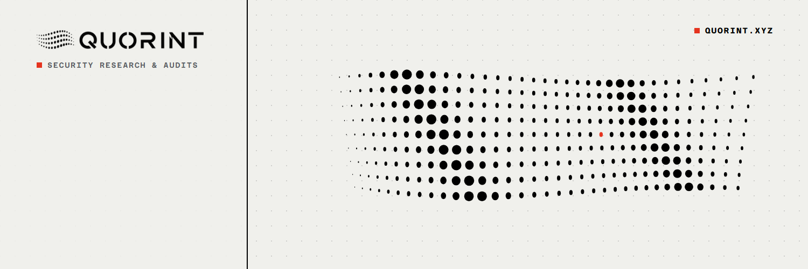

Independent security research and audits for blockchains, L1 protocols, zero-knowledge systems and smart contracts.

- **L1 blockchains and node infrastructure:** full nodes, consensus engines, P2P networking and mempool validation in Rust, Go and C++.
- **Smart contracts and DeFi:** EVM/Solidity and Vyper, Rust on SVM and CosmWasm, including cross-chain bridges and governance contracts.
- **Cryptography and zero-knowledge systems:** ZK circuits, signature schemes, pairing and elliptic-curve primitives, and key management.

Every review is principal-led: line-by-line manual auditing combined with custom stateful fuzzing, differential testing and reproducible proofs of concept.

### Research

- [Decimal-Exponent Bomb in Gonka](https://quorint.xyz/research/gonka-decimal-exponent-bomb/): a Critical consensus-liveness vulnerability, fixed and rewarded through Gonka's bug bounty.
- [Two Critical consensus-divergence vulnerabilities in Zcash's Zebra node](https://quorint.xyz/research/zebra-pre-release-consensus-divergences/), caught before release.

### Audits

- Zakura: protocol architecture, consensus logic and core implementation (in progress).
- Zcash Voting: cryptographic voting protocol and zero-knowledge ballot verification (in progress).

Reports are published at [quorint.xyz/audits](https://quorint.xyz/audits/) once each engagement completes.

### Open proposal

[Gonka security proposal](https://github.com/quorint/gonka-security-proposal): an independent security review for the Gonka bridge relaunch, followed by an attack registry, an economic attack simulator and upgrade audits.

### Contact

Audit and review requests: [contact@quorint.xyz](mailto:contact@quorint.xyz). To report a vulnerability in one of our tools, email us instead of opening a public issue.
